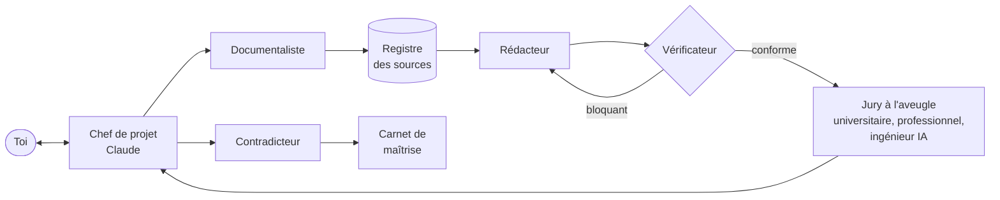

# Kit mémoire avec Claude Code

Un système prêt à l'emploi pour mener un mémoire de master de bout en bout avec [Claude Code](https://claude.com/claude-code) : une petite équipe d'agents spécialisés, des règles de vérité outillées, un jury qui note chaque version à l'aveugle, et toute la mémoire du projet dans de simples fichiers texte.

Il est né d'un vrai mémoire de master en sciences de gestion, puis a été rendu générique : il s'adapte à n'importe quel sujet, n'importe quelle école, démarche qualitative ou quantitative. Tu n'as pas besoin de savoir coder.

## L'idée

Un bon mémoire tient moins au talent d'un rédacteur qu'à une organisation : quelqu'un cherche, un autre vérifie, un troisième écrit, un jury critique, et l'on garde la trace de tout. Le kit reproduit cette organisation avec des agents. **Celui qui écrit n'est jamais celui qui vérifie, ni celui qui note.**

## Ce qu'il te faut

- **Claude Code**, avec un abonnement Claude qui y donne accès : l'application de bureau Claude (onglet Code) ou la version terminal.
- **Python 3** : déjà présent sur Mac ; sur Windows, à installer depuis python.org. Aucune bibliothèque supplémentaire.
- **Les documents de ton école** : guide du mémoire et grilles d'évaluation (PDF).
- Facultatif : **git**, pour garder l'historique de chaque version.

## Démarrer en cinq minutes

1. **Récupère le kit** : sur cette page, bouton vert « Code » puis « Download ZIP », et dézippe-le. Ou, si tu connais git : `git clone` de ce dépôt.
2. **Renomme le dossier** comme tu veux (exemple : « Mon mémoire »).
3. **Dépose les documents de ton école** dans `consignes/originaux/`.
4. **Ouvre le dossier dans Claude Code** : dans l'application, onglet Code, choisis ce dossier ; en terminal, place-toi dans le dossier et tape `claude`.
5. **Tape `/demarrer`**. Claude te pose une dizaine de questions (école, calendrier, sujet, terrain, politique de l'école sur l'IA) et configure tout : fiche du projet, synthèse des consignes, grilles du jury, veille.
6. **Ouvre une nouvelle session** (les agents personnalisés se chargent au démarrage), puis tape `/tournoi` pour choisir ta problématique.

Ensuite, chaque session commence par « on reprend » et se termine par `/fin-de-session`.

## Comment ça marche

### L'équipe

| Agent | Ce qu'il fait | Ce qu'il n'a pas le droit de faire |
|---|---|---|
| Chef de projet (la session principale) | parle avec toi, organise, tient l'état d'avancement | décider à ta place d'un grand tournant |
| documentaliste | cherche la littérature, prouve que chaque source existe, récupère les résumés, fait les fiches de lecture | écrire le mémoire ou le registre |
| redacteur | écrit selon les consignes de ton école, avec ta voix, à partir des seules sources du registre | inventer quoi que ce soit |
| verificateur | contrôle chaque référence, chiffre et citation contre la source ; peut bloquer un texte | « corriger » une source en devinant |
| jury-academique | note avec la grille officielle de l'étape et une grille d'excellence | savoir quelle version il note |
| jury-pro | note du point de vue d'un décideur de ton secteur | idem |
| jury-ingenieur-ia | note la traçabilité, la solidité des sources, la qualité d'écriture, la rigueur | idem |
| contradicteur | cherche les failles, prépare les questions difficiles | adoucir ses critiques |

### Les commandes

| Commande | Quand | Ce qui se passe |
|---|---|---|
| `/demarrer` | une seule fois, au début | entretien de configuration, synthèse des consignes, grilles, veille |
| `/tournoi` | pour choisir la problématique | état de l'art court, 2 à 4 pistes rédigées par des agents distincts, jury à l'aveugle, tu tranches |
| `/jury` | à chaque version d'un texte | vérification, puis trois juges à l'aveugle, notes enregistrées, propositions d'amélioration à valider |
| `/fin-de-session` | à la fin de chaque session | état mis à jour, leçons, idées, décisions, sauvegarde |

Pour le reste, parle normalement. Exemples : « Cherche les travaux fondateurs sur tel concept », « Propose-moi un plan pour le livrable 1 », « Rédige l'introduction selon le plan validé », « Fais vérifier la v2 », « Lance le contradicteur sur ma problématique », « Mets la v3 en Word », « Prépare-moi un oral blanc ».

### Les niveaux de preuve

Une source n'existe pour le mémoire que si elle est dans `sources/REGISTRE.csv`, avec son niveau :

| Niveau | Ce qui a été vérifié | À quoi il sert |
|---|---|---|
| N1 | la source existe (Crossref, arXiv, OpenAlex, site officiel) | le tri |
| N2 | le résumé original des auteurs a été lu, en texte brut | le tri |
| N3 | le texte intégral a été lu | **seul niveau permis pour citer dans un livrable** |

Un résumé produit par une IA ou un outil web ne vaut jamais N2 : il peut inventer un chiffre (c'est arrivé, voir `systeme/LECONS.md`). Quand un texte n'est pas en accès libre, Claude te donne le lien exact et le nom du fichier à enregistrer (`sources/A_TELECHARGER.md`).

### Le jury

Trois juges, qui ne savent ni qui a écrit le texte, ni de quelle version il s'agit. Chaque note est justifiée par une citation du texte. Les grilles sont figées pour que les notes restent comparables d'une version à l'autre. Un document de travail est noté une fois par juge (modèle sonnet) ; un livrable officiel deux fois (opus et sonnet). Toutes les notes vont dans `jury/NOTES.csv` : on voit si l'on progresse. Détail : `jury/LISEZMOI.md`.

### Le moteur d'amélioration

- **Leçons** (`systeme/LECONS.md`) : chaque erreur constatée devient une règle. Le kit en livre quatorze, tirées du premier mémoire.
- **Boîte à idées** (`idees/BOITE_A_IDEES.md`) : chaque idée est notée sur 20 ; aucune n'est jamais supprimée.
- **Veille** : chaque semaine si tu le souhaites, les nouvelles publications sur ton sujet (OpenAlex, arXiv).
- **Décisions** (`DECISIONS.md`) : chaque grand tournant est daté, avec tes mots.

## Le dossier

| Fichier ou dossier | Contenu |
|---|---|
| `CLAUDE.md` | les règles permanentes, lues automatiquement par Claude à chaque session |
| `PROJET.md` | la fiche de ton projet : école, sujet, calendrier, terrain, politique sur l'IA |
| `ETAT.md` | où on en est et le plan de la prochaine session |
| `DECISIONS.md` | tes décisions datées |
| `consignes/` | les documents de ton école (`originaux/`, non copiés dans git) et leur synthèse |
| `sources/` | le registre, les résumés, les fiches, les textes intégraux (`pdf/`, non copiés dans git) |
| `memoire/` | tes textes, toutes versions, et le carnet de maîtrise |
| `jury/` | le protocole, les grilles, les notes |
| `terrain/` | le protocole de confidentialité ; seul `anonymise/` est lu par Claude |
| `systeme/` | leçons, journal des changements, protocole de tri, réglages (`config.json`), outils |
| `veille/` | les résultats de la veille |
| `.claude/` | les agents et les commandes |

Les outils de `systeme/outils/` se lancent seuls : Claude s'en charge. Pour mémoire : `verifier_sources.py` (registre, résumés), `recherche_systematique.py` (recherche reproductible dans OpenAlex), `veille.py`, `noter.py` (notes du jury), `compter_mots.py`, `remplir_modele.py` (remplit le modèle Word de l'école), `md2docx.py` (version Word avec page de garde, s'il n'y a pas de modèle), `verifier_word.py` (contrôle avant remise des informations cachées d'un Word : auteur, société, compte d'entreprise).

## Intégrité : à lire avant de commencer

- **Respecte la politique de ton école sur l'IA.** Renseigne-la dans `/demarrer` ; si l'école demande de déclarer l'usage de l'IA, déclare-le. Le kit est conçu pour la transparence (tout est tracé, daté, vérifiable), pas pour cacher quoi que ce soit, et Claude refusera d'aider à dissimuler un usage que l'école demande de déclarer.
- **Rien n'est inventé** : ni source, ni chiffre, ni entretien, ni donnée. Le terrain, c'est toi qui le fais.
- **Tu dois pouvoir défendre chaque ligne.** C'est le rôle du contradicteur et du carnet de maîtrise ; relis, comprends et réécris ce que tu veux.
- **Confidentialité** : les données brutes du terrain restent dans un dossier privé, hors du projet, que Claude ne lit jamais (`terrain/LISEZMOI.md`).

## Coût et conseils

- Le poste le plus cher est le jury d'un livrable officiel : six évaluations (trois juges, deux modèles). Garde-le pour les versions qui comptent ; pour un brouillon, un passage par juge suffit.
- Une demande claire par session vaut mieux que dix petites.
- Avant chaque nouvelle version d'un texte, Claude te présente la liste des changements et leur raison : valide-la avant qu'il l'applique. C'est la leçon la plus coûteuse du premier mémoire (`systeme/LECONS.md`, L-012).

## Garder ton mémoire privé

Une fois configuré, ton dossier contient ton nom, ton sujet et tes textes : ne le publie pas. Si tu as récupéré le kit avec `git clone`, `/demarrer` te propose de le détacher de ce dépôt pour ne jamais y envoyer ton travail par erreur.

## Origine, crédits et licence

- Tiré d'un mémoire de master mené avec Claude Code à l'automne 2026 ; les leçons de ce premier projet sont dans `systeme/LECONS.md`.
- Le protocole de tri (`systeme/PROTOCOLE_TRI.md`) et certaines règles du contradicteur et du jury reprennent des idées de Wu, C.-I. (2026), *Academic Research Skills for Claude Code*, https://github.com/Imbad0202/academic-research-skills, sous licence CC BY-NC 4.0.
- Licence du kit : voir `LICENSE`.
